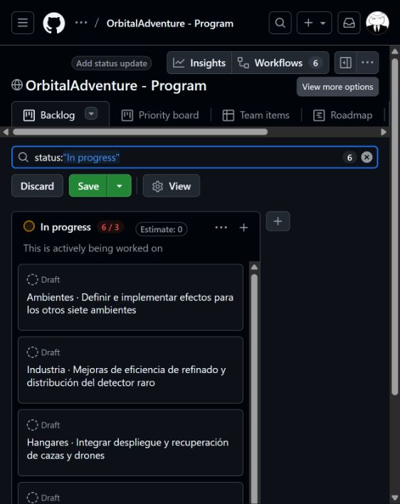

# Pendientes de Hangar Orbital

Actualizado: 20 de noviembre de 2026. Registrados como seis borradores en **In progress** del [Project OrbitalAdventure](https://github.com/users/Pegaxsus/projects/3), según indicación del usuario. Esta columna expresa su ubicación solicitada; los trabajos siguientes aún no están implementados. No se ha publicado código, hecho commit ni push.

## Ambientes: efectos por definir

Nube criogénica ya tiene ralentización e inmunidad Boreal en 0.1.16. Los otros siete conservan su apariencia sin efectos jugables nuevos: Arco de gas, Velo de polvo, Límite planetario, Remanente de supernova, Aurora solar, Vacío profundo y Tormenta iónica. Definir con el usuario sus efectos, intensidades, tiempos y contramedidas antes de implementarlos. Nácar y Vesper son variantes de gas/remanente y seguirán las futuras reglas de su familia cuando se acuerden.

## Industria: ensamblaje y salvaging

Definir componentes requeridos por cada nave/estación/módulo, cantidades, costes, tiempos y balance. Procesado/fabricación/ensamblaje al 100 %, pérdidas sólo en refinado. La recuperación dependerá de componentes requeridos/equipados y podrá dar componentes o materiales refinados; asignarla cuando existan tablas por casco. Hasta entonces se mantiene el salvaging actual. Los componentes industriales no son hardpoints.

## Hangares: cazas y drones

Consumir posiciones y rumbos del editor para desplegar y recuperar. Cazas sólo Carrier/Titán o perk específico; drones según reglas actuales. No inventar hardpoints del usuario. Integrar compuertas, capacidades y comportamiento cuando se defina.

## Cluster01 y facciones

El usuario debe decidir facción, seguridad y atributos de los nuevos sistemas. Definir territorios y patrullas de Helión y otras casas; Asterión ya está implementado. Reputación y diplomacia pendientes de diseño.

## Interfaz: barras de escudo

Pendientes, con recordatorio al retomar interfaz. El destello y el contorno ya existen; no confundirlos con barras. El usuario fue recordado en 0.1.15.

## Industria: mejoras y detector raro

Crear módulos futuros que mejoren eficiencia de refinado y acordar su balance. Definir obtención/distribución del Detector de trazas (ID 11), actualmente sin stock ni portadores. No introducir pérdidas en procesado/fabricación/ensamblaje.

Otros pendientes de menor prioridad: funciones de artefactos a largo plazo; compra de naves en astilleros; equipamiento PDC de capitales y nuevas armas sujetos a futuras peticiones. La sincronización automática de releases con Projects no está implementada; los seis pendientes se han añadido mediante la interfaz y las 71 fichas Done anteriores se conservan.

