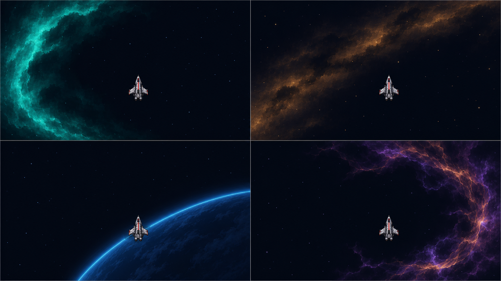

# Ambientes para futuros sectores

| Ambiente | Composición y uso previsto | Perfil en 0.1.6 |
| --- | --- | --- |
| Arco de gas | Media luna turquesa en un lateral y centro oscuro. Para rutas comerciales. | gas-arc |
| Velo de polvo | Banda ámbar diagonal con claros que dejan ver el campo estelar. Para regiones mineras. | dust-veil |
| Límite planetario | Borde azul y superficie en penumbra de un planeta lejano. Para capitales y astilleros. | planet-limb |
| Vacío profundo | Estrellas escasas, galaxia tenue en una esquina y mucho negro. Para sectores aislados. | Pendiente |
| Remanente de supernova | Arco roto de filamentos violetas y cobrizos, con claros para leer el combate. Para regiones remotas. | supernova-remnant |
| Aurora solar | Corona blanca y dorada con filamentos que se pierden en la oscuridad. Para sectores industriales. | Pendiente |

## Asignar un ambiente

Añade una fila a ../../data/sector-backgrounds.txt con el número visible del sector y el ID del perfil, separados por coma. Por ejemplo, para un futuro sector numerado 4116, escribe: 4116,planet-limb. El sector tiene que existir en la red del juego.

Los perfiles de ../../data/background-profiles.txt indican PNG, dimensiones de dibujo, ancla mundial y factor de paralaje. Usa punto decimal. Los cuatro PNG se guardan en ../../assets/backgrounds/ con alfa cero en los bordes. Se dibuja una sola capa por sector, sobre el campo estelar y bajo las entidades. El tamaño y el desplazamiento usan la raíz cuadrada del zoom. El perfil planetario usa un paralaje menor que los demás.

En 0.1.6 siguen asignados los fondos de Nácar (4108) y Vesper (4115). Los cuatro perfiles nuevos están disponibles para futuras asignaciones. Para incorporar un perfil con arte nuevo, añade el PNG al catálogo y a build/resources.rsp para C#, importa y exporta Godot y recompila C#.
