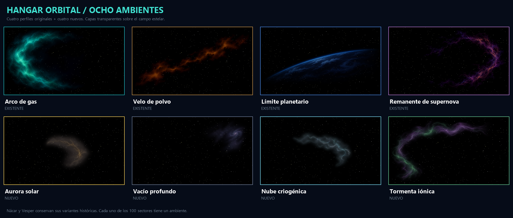

# Ocho ambientes de Hangar Orbital · 0.1.17

Los cuatro perfiles originales se amplían con **Aurora solar, Vacío profundo, Nube criogénica y Tormenta iónica**. Cada uno de los **100 sectores** tiene exactamente un perfil asignado. Desde 0.1.16, Nube criogénica aplica ralentización progresiva a las naves y escarcha, con inmunidad mediante Termorregulador Boreal. Los otros siete ambientes siguen siendo visuales; sus efectos están pendientes de diseño. No se alteran recursos, seguridad, facciones ni conexiones. Consulta [reglas de criogenia](criogenia.md) y [pendientes](../../documentation/pendientes.md).

| Ambiente principal | Perfil | Sectores | Composición |
| --- | --- | ---: | --- |
| Arco de gas | gas-arc | 16 | Arco turquesa de gas con centro abierto y oscuro. |
| Velo de polvo | dust-veil | 11 | Velo ámbar diagonal con claros para leer la escena. |
| Límite planetario | planet-limb | 5 | Horizonte azul de un planeta distante en penumbra. |
| Remanente de supernova | supernova-remnant | 10 | Filamentos de un remanente violeta y cobrizo. |
| Aurora solar | solar-aurora | 18 | Corona tenue de gas dorado, con filamentos cálidos y mucho espacio oscuro. |
| Vacío profundo | deep-void | 19 | Gran vacío negro con una galaxia pequeña y lejana en una esquina. |
| Nube criogénica | cryo-cloud | 17 | Filamentos moleculares azul hielo y gris plateado, reservados a los sistemas de hielo actuales. |
| Tormenta iónica | ion-storm | 4 | Velo curvo de gas verde y violeta con filamentos de ionización. |

Los ocho tipos principales incluyen las **variantes históricas**: Nácar (4108) conserva su nebulosa propia como variante de gas; Vesper (4115) conserva su nebulosa roja intensa como variante de remanente. Hay ocho familias, diez perfiles técnicos contando esas dos variantes, y un único fondo por sector.

## Criterio de asignación

- Los 17 sistemas de hielo usan Nube criogénica.
- Los fondos planetarios y solares se priorizan en estaciones y astilleros.
- Vacío profundo se prioriza en ramales aislados sin estación.
- Los otros sistemas se reparten de forma estable entre los ambientes restantes.
- Nácar y Vesper conservan sus PNG, anclas, paralaje e intensidad.
- Las asignaciones están en datos, no se sortean al cargar. No se cambian las conexiones ni afiliaciones del mapa.

[Mapa estelar con ambientes](mapa-estelar-0.1.17.png) · [Listado de todos los sectores](mapa-estelar.md).

## Integración gráfica

PNG con transparencia real sobre el campo de estrellas existente, detrás de estaciones, naves, asteroides y HUD. Desde 0.1.17 se dibujan tres capas superpuestas por sector, con giros, offsets, escalas, opacidades y paralajes distintos, sin mosaico de nebulosas: por eso no aparecen juntas entre tiles. La receta está en data/background-layers.txt; se mantiene el perfil principal para sus efectos de juego. Los bordes transparentes se comprueban en pruebas y la ilustración termina de forma orgánica antes del límite de la imagen.

Se mantiene el paralaje suave y la escala sqrt(zoom) de ambas ediciones. El perfil tiene opacidad opcional para modular luminosidad sin modificar sus píxeles: los perfiles antiguos de siete columnas siguen usando 1.0. Las cuatro imágenes nuevas se han ajustado para dejar legible el combate.

Los PNG seleccionados se guardan en assets/backgrounds/: solar-aurora-v2.png, deep-void.png, cryo-cloud-v2.png e ion-storm.png. Los borradores iniciales de solar/cryo se conservan en drafts/ con .gdignore y no se empaquetan. El arte definitivo se generó con la herramienta integrada imagegen; [prompts y revisiones](prompts-ambientes-0.1.13.md).

## Datos y mantenimiento

- data/background-profiles.txt: profile,texture,width,height,anchor_x,anchor_y,parallax y opacity opcional (0–1).
- data/sector-backgrounds.txt: dirección numérica 4107+ID interno y perfil. Para sectores con código, usar esa dirección alternativa, no el texto del código; la tabla del mapa da ambos.
- data/background-types.txt: nombres, familia y color para el catálogo y el mapa de referencia. No añade efectos de juego.
- build/render-ambiences.ps1 regenera la lámina de ocho tipos desde los recursos y sus opacidades.
- build/render-star-map.ps1 regenera el mapa con una banda interior de color por ambiente; las formas, hielo, estaciones y escudos de facción siguen representando sus datos anteriores.
- build/test-backgrounds.gd comprueba 100 asignaciones, ocho tipos usados, hielo, variantes históricas y transparencia de los cuatro PNG nuevos.
- build/preview-backgrounds.gd renderiza los ocho ambientes dentro del juego, con un guardado temporal. C# --smoke también comprueba recursos, cobertura, bordes y renderiza los ocho perfiles.

Al añadir un nuevo sector, añadir su asignación y un perfil existente. Al añadir arte nuevo, crear el perfil y empaquetar el PNG en build/resources.rsp para C#; importar/exportar Godot. Los cambios de fondo proceden de datos y se aplican también al cargar partidas antiguas sin alterar su progreso.
