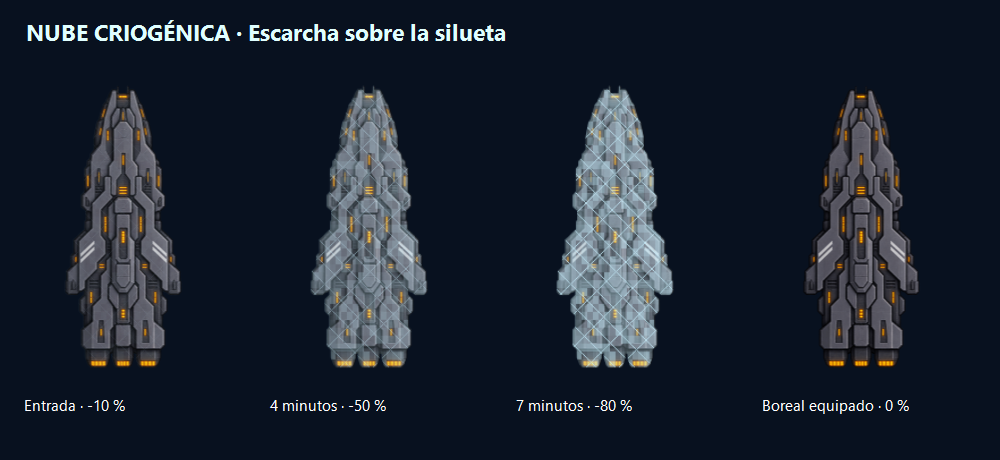
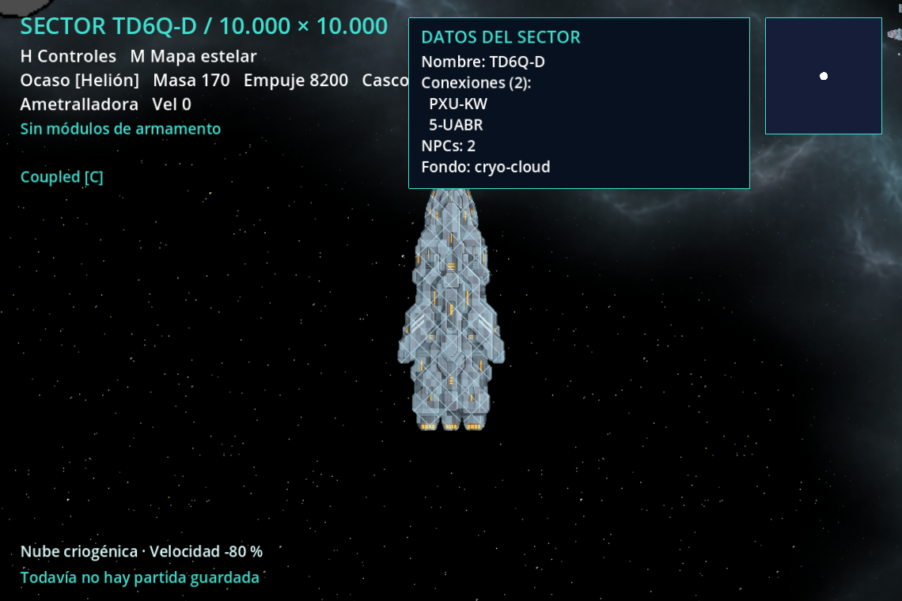

# Nube criogénica · 0.1.16

Los 17 sectores de hielo de data/sectors.txt usan cryo-cloud en data/sector-backgrounds.txt; la asignación ya coincidía y se ha vuelto a verificar. No se modifican minería, conexiones ni territorios.

## Ralentización

Afecta al jugador y a NPC presentes, incluidos mineros, patrullas, piratas, traders, escoltas y mercantes. Cada nave tiene su propio tiempo de exposición por visita. Los NPC nuevos comienzan al 10 %, aunque el jugador lleve más tiempo dentro.

| Tiempo en vuelo dentro del sistema | Reducción de velocidad | Velocidad disponible |
| --- | ---: | ---: |
| Entrada, menos de 1 minuto | 10 % | 90 % |
| 1 minuto | 20 % | 80 % |
| 2 minutos | 30 % | 70 % |
| 3 minutos | 40 % | 60 % |
| 4 minutos | 50 % | 50 % |
| 5 minutos | 60 % | 40 % |
| 6 minutos | 70 % | 30 % |
| 7 minutos o más | 80 % | 20 % |

Las reducciones son puntos porcentuales sobre la velocidad normal, no multiplicaciones sucesivas. Se reduce la velocidad máxima de vuelo y la velocidad objetivo del piloto automático/NPC; la velocidad se limita al nuevo máximo cuando corresponde. Thrusters sigue mejorando la velocidad base antes de aplicar el frío. Giro, empuje, daño, proyectiles, minería, escudos y alcance FTL no cambian. Las animaciones de entrada/salida FTL conservan su efecto.

Al abandonar el sector por puerta, FTL o tp, se reinicia la exposición. Si el siguiente sistema también es criogénico, empieza de nuevo al 10 %. En otros ambientes no existe ralentización ni escarcha. Los mercantes aplican la misma regla al cambiar de sistema, incluidos los tramos simulados fuera de pantalla. Atracado, el contador se pausa y no se dibuja escarcha; al desatracar continúa la exposición de esa visita. Las pausas de consola/mapa no acumulan tiempo.

Guardar/cargar conserva la exposición del jugador y del transporte mercante. Una partida anterior empieza con exposición cero y el efecto base al entrar en juego. Los NPC normales se generan como hasta ahora al cargar y empiezan su visita al 10 %.

## Termorregulador Boreal

| Propiedad | Valor |
| --- | --- |
| ID estable | 12 |
| Categoría | Utilidad |
| Huecos | 1 |
| Compra | 1.800 créditos |
| Venta | 900 créditos |
| Stock inicial de estación | 2 |
| Activación | Pasiva, al estar equipado en la nave actual |
| Efecto | Inmunidad completa a ralentización y escarcha criogénicas |

En la bodega/inventario no protege. No acumula bonos por instalar varios. No se equipa de fábrica en NPC; el modelo admite NPC protegidos para futuras distribuciones. El tiempo de visita sigue corriendo con el módulo equipado, pero sus efectos quedan anulados: si se retira, vuelve el nivel que corresponda a esa visita. No afecta a otros ambientes. El detector raro conserva ID 11 y stock cero. Los IDs y equipamientos anteriores permanecen válidos; los mercados antiguos conservan sus existencias y reciben dos Boreal en la nueva posición.

Icono vectorial nativo: assets/modules/boreal.svg; equivalente dibujado en C#. Máscara de escarcha azul/blanca recortada por el alfa del casco, con vetas cristalinas e intensidad proporcional al porcentaje. No se alteran sprites fuente ni máscaras de colisión. HUD inferior muestra el porcentaje o Boreal activo.

## Verificación

build/test-cryogenic.gd y RunCryogenicSmoke en csharp/Cryogenic.cs verifican los 17 sectores, los escalones y límites, inmunidad sólo equipada, NPC nuevos/protegidos, compra, guardado/carga, velocidades de mercantes y reinicio por puertas/cambio de sector. C# también verifica migración de stock de 12 a 13 módulos. Regresiones de fondos, clúster, industria, consola y atraques superadas.
