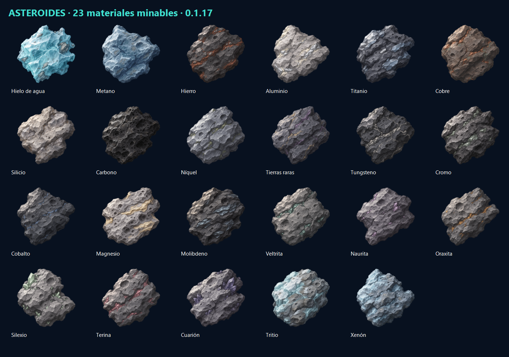
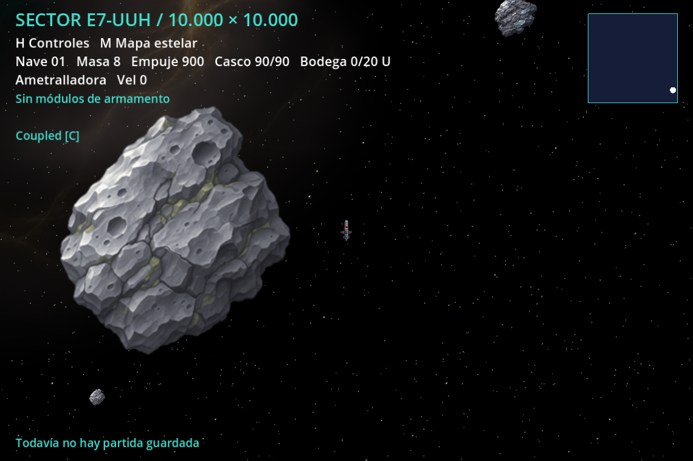
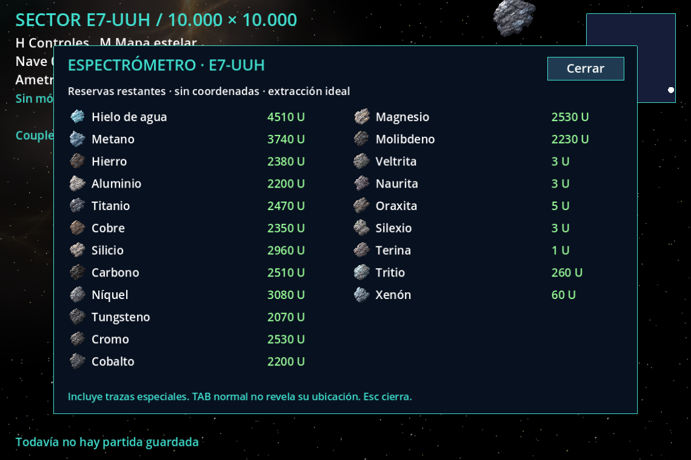

# Exploración y recursos · 0.1.17

## Estación Umbral

E7-UUH (ID 29, dirección alternativa 4136) recibe Estación Umbral, índice persistente 15, en (0,0). Reutiliza el modelo BI, tamaño 300, masa 6.800 y casco 34.000. Dos puertos normales y dos capitales, PDC, mercados, inventario y refinado/fabricación habituales; eficiencia base de refinado 80 %, fabricación 100 %. No es un astillero. No se asigna facción nueva. Se añade al final del catálogo para conservar índices de las 15 estaciones anteriores.

El universo mantiene 100 sectores y 116 enlaces; pasa a 16 estaciones (siete dentro de Cluster01). [Mapa claro actualizado](mapa-estelar-0.1.17.png) y tabla mapa-estelar.md. La referencia original del clúster se conserva; la estación es una modificación posterior del usuario.

## Tres capas de ambiente

Cada uno de los diez perfiles técnicos tiene tres capas definidas en data/background-layers.txt. Se conserva el sprite principal, se superpone una copia girada y desplazada y una textura relacionada del catálogo. Cada capa tiene escala, offset, giro, paralaje y opacidad; las secundarias son tenues para preservar lectura. No hay mosaico de nebulosas ni bordes opacos. La clasificación del sector y sus efectos dependen del perfil principal: superponer gas a cryo-cloud no cambia ni multiplica sus reglas. El efecto de criogenia se mantiene; los otros siete ambientes siguen pendientes de efectos.

## Asteroides minerales

23 PNG nuevos y distintos generados con image_gen integrado, con alfa transparente y acentos desaturados. Hielo de agua, metano, tritio y xenón usan tonos fríos. Catálogo compartido data/asteroid-materials.txt; archivos en assets/asteroids/materials/. Los originales anteriores siguen disponibles. Prompts exactos en prompts-asteroides-0.1.17.json. Se recorta el margen transparente y se prepara el sprite en memoria, sin modificar los PNG fuente ni alterar colisiones.

En el sector, la textura refleja el material principal del asteroide. Las trazas especiales ocultas NO cambian su apariencia ni revelan dónde están. Sus ilustraciones aparecen en el informe agregado y quedan disponibles para asteroides cuyo material principal sea ese en el futuro. El material secundario mantiene su valor aunque no cambie el sprite principal. Los sprites no alteran los porcentajes de hielo ni la distribución de gases o especiales.

## Gigantes

Entre dos y cuatro de los 640 asteroides de cada sector son gigantes: 299 en total, aproximadamente 0,47 % del campo. Radio 150–240, diámetro 300–480. Se colocan de forma determinista en zonas exteriores de distintos cuadrantes, separados de los demás; se preserva la composición de sus posiciones del catálogo. Los pequeños conservan su distribución anterior salvo los pocos índices promovidos a gigantes.

Producen entre 24 y 32 fragmentos normales, 240–320 U en extracción ideal, repartidas entre sus materiales. La minería tarda entre 10 y 16 segundos de progreso correcto según radio, frente a tres segundos en los normales. Las ventanas de potencia, penalización por sobrecarga, especiales y puntos de vida base conservan sus reglas. El total del espectrómetro corresponde a esa extracción ideal, no a la pérdida por sobrecarga ni al refinado posterior.

La regeneración mantiene tamaño y material. Se comprueban límites, radio del asteroide, distancia al jugador, estaciones, puertas y otros asteroides. Se conserva el ciclo de respawn anterior. Un guardado anterior conserva salud y progreso: para los índices promovidos se usa la posición nueva segura, evitando agrandar un asteroide antiguo encima del jugador o de una estación. Los guardados nuevos conservan sus posiciones de gigantes.

## Espectrómetro de materiales

| Propiedad | Valor |
| --- | --- |
| ID estable | 13 |
| Categoría | Utilidad, un hueco |
| Compra / venta | 2.600 / 1.300 créditos |
| Stock inicial por estación | 2 |
| Activación | Completar un escaneo TAB con el módulo equipado |
| Informe | Materiales y cantidades restantes en todos los asteroides vivos del sector |
| Localización | No proporciona coordenadas, distancias ni marcas de ubicación |

Incluye materiales principales/secundarios, gases escasos y trazas especiales. Suma materiales repetidos y excluye asteroides agotados/en respawn, restos, inventarios, drops y carga de NPC. Es una instantánea al completar el barrido; repetir TAB para actualizarla tras extraer. La ventana pausa la simulación y se cierra con Esc, Enter o Cerrar. En inventario sin equipar no se activa. No se equipa de fábrica a NPC.

No sustituye al Detector de trazas (ID 11), que permite localizar especiales en asteroides alcanzados por el escaneo local y sigue siendo raro sin distribución. El espectrómetro sólo da cifras globales; el escaneo normal sigue sin revelar ubicaciones especiales. Boreal (ID 12) permanece sin cambios. Los IDs anteriores se mantienen y los guardados antiguos reciben dos espectrómetros en el nuevo hueco del mercado.

## Puertas exteriores

Las 232 entradas físicas (dos por cada enlace) se sitúan en los bordes cardinales de cada sector. El margen entre el borde exterior del sprite de radio 67 y el límite del mapa es 200–500 unidades; la distancia del centro al origen es 4.433–4.733. El margen varía de forma estable por sector/enlace. No cambian destinos, nomenclatura, exploración ni alcance FTL.

Se despeja una zona de llegada de 300 unidades más el radio de cada asteroide, también al cargar. El punto de llegada sigue desplazado hacia el interior. Mineros sin estación y mercantes usan las posiciones nuevas, sin coordenadas antiguas incrustadas.

## Verificación

build/test-survey.gd y RunSurveySmoke verifican estación, mercados, tres capas, 23 sprites, 299 gigantes, 232 márgenes/zonas despejadas, totales exactos, inmunidad a mostrar ubicación especial, equipamiento, cierre, compra y persistencia. La prueba Godot también simula posiciones de gigantes en un guardado antiguo. C# comprueba alfa de todos los sprites originales al generar el catálogo. Regresiones anteriores conservadas. Se renderizan y revisan estación, gigantes, informe, fondos y mapa.
